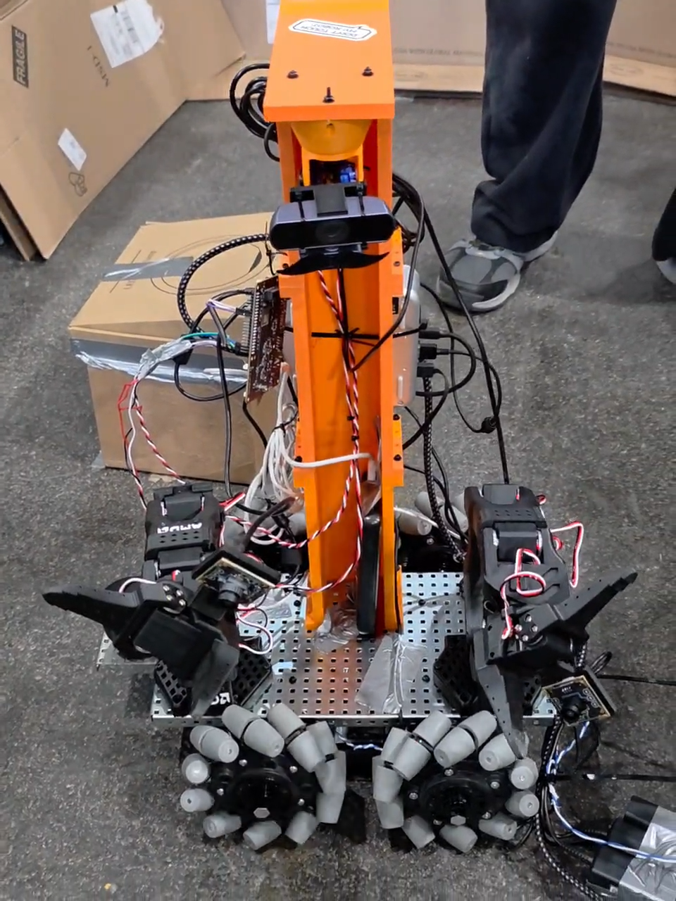

# GUARD.IAM

<p align="center">
  
  
  
  
  
  
  
</p>

<p align="center">
  <b>🥈 2nd Place — Microsoft Track &nbsp;·&nbsp; 🥉 3rd Place — AMD Track</b><br>
  <i>StarkHacks 2026 · World's Largest Hardware Hackathon · 750+ participants · 36 hours</i>
</p>

**G**round **U**nit for **A**utonomous **R**econnaissance, **D**istal **I**ntervention, and **A**rm **M**anipulation — a fully autonomous confined space intervention rover with dual robotic arms, built from scratch in 36 hours at StarkHacks 2026. GUARD.IAM navigates autonomously to a target, executes bimanual manipulation tasks, and hands off to a human operator via **Meta Quest 3 Mixed Reality** when a decision is too critical to automate.

---

## Table of Contents

- [Demo](#demo)
- [Overview](#overview)
- [System Architecture](#system-architecture)
- [Subsystems](#subsystems)
  - [Autonomous Navigation](#autonomous-navigation)
  - [Mecanum Drive & Motor Control](#mecanum-drive--motor-control)
  - [Sensor Fusion & Localization](#sensor-fusion--localization)
  - [Dual-Arm Manipulation](#dual-arm-manipulation)
  - [Mixed Reality Teleoperation](#mixed-reality-teleoperation)
  - [LeRobot Imitation Learning](#lerobot-imitation-learning)
- [Key Algorithms](#key-algorithms)
- [Project Structure](#project-structure)
- [Installation & Build](#installation--build)
- [Running the System](#running-the-system)
- [Configuration Reference](#configuration-reference)
- [ROS2 Topic Reference](#ros2-topic-reference)
- [Dependencies](#dependencies)
- [Team](#team)

---

## Demo



*GUARD.IAM v1 — holonomic mecanum platform with dual SO-101 arms, dual Scanse Sweep LIDAR, and AMD Ryzen AI compute. Built in 36 hours at StarkHacks 2026; drive, sensing, and the teleop/arm stack have since moved on from this v1 build (see Subsystems below).*


*Bimanual manipulation task — dual SO-101 arms executing a coordinated open-box sequence via LeRobot imitation learning.*

---

## Overview

GUARD.IAM is designed for **confined space intervention** — environments where a human cannot safely operate: oil & gas pipelines, nuclear facilities, underground infrastructure. The system combines:

| Layer | Capability |
|---|---|
| **Autonomous navigation** | Nav2 + EKF sensor fusion — navigates to a target without human input |
| **Holonomic drive** | Mecanum kinematics — full omnidirectional movement in tight spaces |
| **Dual-arm manipulation** | SO-101 arms controlled via LeRobot imitation learning |
| **MR teleoperation** *(planned)* | Meta Quest 3 — head-tracked camera, hand-tracking arm control for human-in-the-loop fallback |
| **AI inference** | AMD Ryzen AI MiniPC running VLA policy inference on-board |

**Background:** Three ACS students entered StarkHacks 2026 with no hardware, no chassis, and no working code. 36 hours later they won two prizes and attracted sponsorship interest from AMD, Microsoft, Espressif, Qualcomm, Ouster, and CubeMars. GUARD.IAM is now being developed as a formal ICON Student Team Project at Purdue under Prof. Yu She (MARS Lab) and Prof. Shaoshuai Mou, targeting ICRA/IROS 2027.

---

## System Architecture

```
┌──────────────────────────────────────────────────────────────────────┐
│                         GUARD.IAM Platform                           │
│                                                                      │
│  ┌──────────────────────┐        ┌──────────────────────────────┐   │
│  │  Operator Interface  │        │      Sensor Stack            │   │
│  │  (planned)            │        │                              │   │
│  │  Meta Quest 3         │        │  Scanse Sweep V1 LIDAR ×2     │   │
│  │  Head-tracked MR      │        │  (front + back, merged)       │   │
│  │  Hand tracking        │        │  Wheel odom — derived from    │   │
│  │  SO-101 arms          │        │  Phidget BLDC hall counts      │   │
│  │  (leader side being   │        │                              │   │
│  │  reworked)            │        │                              │   │
│  └──────────┬───────────┘        └──────────────┬───────────────┘   │
│             │ WebSocket                          │ ROS2 topics       │
│             ▼                                    ▼                   │
│  ┌──────────────────────────────────────────────────────────────┐   │
│  │                  AMD Ryzen AI MiniPC                          │   │
│  │           ROS2 Jazzy — everything runs here, no               │   │
│  │           separate onboard microcontroller in the drive loop  │   │
│  │                                                               │   │
│  │  guardian_bringup     guardian_localization                   │   │
│  │  guardian_drive       guardian_arms                           │   │
│  │  guardian_teleop      guardian_description                    │   │
│  │                                                               │   │
│  │  Nav2 ─── EKF (robot_localization) ─── LeRobot inference     │   │
│  │  Mecanum kinematics ─── /cmd_vel ─── phidget_bridge_node      │   │
│  └──────────────────────────┬─────────────────────────────────┘    │
│                              │ USB (Phidget VINT hub)                │
│                              ▼                                        │
│              ┌────────────────────────────────┐                     │
│              │  Phidget BLDC motor channels     │                     │
│              │  custom outer-loop PID ×4,       │                     │
│              │  active braking (phidget_bldc_   │                     │
│              │  node.py)                        │                     │
│              └───┬───────┬───────┬───────┬─────┘                     │
│                  ▼       ▼       ▼       ▼                           │
│                 FL      FR      BL      BR                           │
│           [Phidget BLDC motors × 4]                                  │
│           [Mecanum wheels × 4]                                       │
└──────────────────────────────────────────────────────────────────────┘
```

---

## Subsystems

### Autonomous Navigation

**Package:** `30_ros2_ws/src/guardian_bringup/`

Nav2 full navigation stack configured for indoor confined spaces. The rover receives a goal pose and autonomously plans and executes a path using the Nav2 behavior tree, replanning dynamically around obstacles detected by the Scanse Sweep LIDAR.

<details>
<summary><b>Launch configurations</b></summary>

One unified launch file, `guardian.launch.py`, covers every combination via arguments:

```bash
ros2 launch guardian_bringup guardian.launch.py                                  # sim, navigation, RViz
ros2 launch guardian_bringup guardian.launch.py use_sim:=false mode:=mapping     # real hardware, SLAM mapping
ros2 launch guardian_bringup guardian.launch.py use_sim:=false                  # real hardware, navigation
ros2 launch guardian_bringup guardian.launch.py rviz:=false                     # headless
```

Key arguments: `use_sim` (`true`/`false`), `mode` (`mapping`/`navigation`), `rviz`,
`teleop`, `map`, `known_pose`, `world`/`spawn_x`/`spawn_y`/`spawn_z` (sim only).
See `30_ros2_ws/src/guardian_bringup/README.md` for the full list.

Nav2 behavior tree: `config/navigate_to_pose.xml` — standard navigate-to-pose with obstacle recovery.

</details>

---

### Mecanum Drive & Motor Control

**Packages:** `30_ros2_ws/src/guardian_drive/` · `60_scripts/phidget_bldc_node.py`

ROS 2 handles kinematics; the outer-loop velocity PID for all four wheels now runs directly against the Phidget BLDC motor channels over USB (VINT hub) — there is no separate onboard microcontroller in the drive loop anymore.

<details>
<summary><b>Mecanum kinematics</b></summary>

`mecanum_kinematics_node.py` converts `/cmd_vel` (`Twist`) to four individual wheel RPM targets:

```
FL = (vx − vy − (L+W)·ω) / r · (60/2π)
FR = (vx + vy + (L+W)·ω) / r · (60/2π)
BL = (vx + vy − (L+W)·ω) / r · (60/2π)
BR = (vx − vy + (L+W)·ω) / r · (60/2π)
```

Peak RPM is clamped while preserving inter-wheel ratios to prevent kinematic distortion at velocity limits.

**Parameters:** `wheel_radius` = 0.0748 m · `wheel_base_length` = 0.25 m · `wheel_base_width` = 0.20 m · `max_rpm` = 251.0

</details>

**Phidget BLDC control** (`phidget_bldc_node.py`): one `BLDCMotor` channel per wheel, opened once at startup and held open for the whole session — deliberately not a switching state machine. `BrakingEnabled=True` is set once so the firmware applies real active braking when target velocity is 0, instead of coasting. Velocity feedback is derived by differentiating raw hall-commutation position counts over time (the channel's own `getVelocity()` reports duty cycle, not RPM, so it's unusable as PID feedback directly). The loop is P+I only — derivative gain was confirmed on the bench to amplify hall-based velocity noise into real chattering, so Kd is intentionally not implemented.

---

### Sensor Fusion & Localization

**Package:** `30_ros2_ws/src/guardian_localization/`

`robot_localization` EKF runs at **50 Hz**, producing `/odometry/filtered` for Nav2. GPS is explicitly excluded — GUARD.IAM operates indoors where GPS is unavailable.

| Sensor | Topic | Rate | Role in EKF |
|---|---|---|---|
| Wheel odom (Phidget BLDC hall counts) | `/odom` | 50 Hz | Current sole localization input — dead reckoning |
| Scanse Sweep V1 LIDAR ×2 (front + back) | `/scan_filtered` | 5 Hz | Obstacle avoidance / costmap, not currently fused into the EKF |

The T265 and MPU-6050 IMU from the original build are not part of the current real-hardware pipeline — `guardian_hardware.launch.py` and `ekf_params_real.yaml` only bring up the dual LIDARs and the Phidget-derived wheel odometry. Re-adding a visual or inertial source is on the roadmap but not wired in yet.

Two `l3xz_sweep_scanner` nodes (`sweep_scanner_front`, `sweep_scanner_back`) read the LIDARs over `/dev/lidar_front` / `/dev/lidar_back` (udev-aliased, not raw `/dev/ttyUSB*`, so they survive reboots/replugs). `lidar_republisher_node.py` filters each into a standard `LaserScan`, and `lidar_merger_node.py` combines front + back into one `/scan_filtered` for Nav2's costmap.

---

### Dual-Arm Manipulation

**Package:** `30_ros2_ws/src/guardian_arms/`

Two SO-101 follower arms (LeRobot hardware) mounted on the rover chassis. The leader-side arms used for teleoperation are currently being reworked. `arm_manager_node.py` handles joint state publishing and command routing. `teleop_bridge_node.py` relays joint commands from either the Quest 3 hand-tracking interface or the LeRobot policy inference output.

**Training data collection:** `scripts/collect_training_data.py` records synchronized arm joint states + camera frames into the LeRobot dataset format for imitation learning.

**Dataset:** `40_lerobot/datasets/open_box/` — 4 demonstration episodes of a bimanual box-opening task (3 camera streams: `left_camera1`, `left_camera2`, `right_camera3`).

---

### Mixed Reality Teleoperation *(planned)*

**Package:** `30_ros2_ws/src/guardian_teleop/` · `50_teleop/quest_bridge/`

`quest_bridge_node.py` connects to the Meta Quest 3 via WebSocket (`websocket_bridge.py`). Head orientation is intended to drive a PTZ camera on the rover, with hand-tracking mapped to joint commands for both SO-101 arms via `teleop_bridge_node.py`, once the leader-arm rework is done.

Fallback modes: `joystick_fallback_node.py` (gamepad) and `keyboard_teleop_node.py` (keyboard).

---

### LeRobot Imitation Learning

**Directory:** `40_lerobot/`

SO-101 arm policies trained using [LeRobot](https://github.com/huggingface/lerobot) imitation learning on demonstration episodes.

**Record episodes:**
```bash
bash 40_lerobot/datasets/record_single_arm.sh
bash 40_lerobot/datasets/record_dual_arm.sh
```

**Train:**
```bash
bash 40_lerobot/training/train_single_arm.sh
bash 40_lerobot/training/train_dual_arm.sh
```

**Evaluate:**
```bash
bash 40_lerobot/eval/eval_dual_arm.sh
```

Policy config: `40_lerobot/configs/guardian_policy_config.yaml`

---

## Key Algorithms

### Mecanum Inverse Kinematics

Converts a desired body velocity `(vx, vy, ω)` to four wheel angular velocities. The key property of mecanum drive is that the 45° roller angle on each wheel projects lateral force components — allowing full holonomic motion (translation in any direction + rotation simultaneously) without wheel steering.

```
[FL]   [ 1  -1  -(L+W)] [vx]
[FR] = [ 1   1   (L+W)] [vy] · (1/r) · (60/2π)
[BL]   [ 1   1  -(L+W)] [ω ]
[BR]   [ 1  -1   (L+W)]
```

### EKF Sensor Fusion

`robot_localization` currently runs on wheel odometry alone at 50 Hz — a visual or inertial correction source (T265 / IMU) is not fused in yet, so long-horizon drift is not actively corrected. Re-adding one is on the roadmap.

### PID Wheel Control (Phidget BLDC)

Each of the four wheels runs an independent outer-loop P+I velocity controller in `phidget_bldc_node.py`, comparing a measured RPM (differentiated from the motor's hall-count position) against the target RPM from the ROS 2 kinematics node, and adjusting duty cycle to minimize the error. `BrakingEnabled=True` is set once per channel at startup so the Phidget firmware applies real active braking at zero target velocity, rather than coasting.

---

## Project Structure

```
AutomousRover_StarkHacks/
├── README.md
├── figures/
│   ├── guardian_rover.jpg                ← rover photo
│   └── bimanual_manipulation_demo.mp4    ← bimanual task demo
├── 10_docs/                              ← architecture, hardware, setup docs
│   ├── architecture/
│   │   ├── system_overview.md
│   │   ├── control_architecture.md
│   │   └── sensor_fusion.md
│   ├── hardware/
│   │   ├── bill_of_materials.md
│   │   ├── wiring_diagram.md
│   │   └── power_system.md
│   └── setup/
│       ├── dependencies.md
│       ├── amd_minipc_setup.md
│       └── arduino_setup.md
├── 20_hardware/                          ← CAD and embedded firmware
│   └── cad/                              ← chassis CAD files
├── 30_ros2_ws/                           ← ROS 2 Jazzy colcon workspace
│   └── src/
│       ├── guardian_bringup/             ← launch files + Nav2 config
│       ├── guardian_description/         ← URDF/xacro robot model
│       ├── guardian_drive/               ← mecanum kinematics + phidget_bridge_node
│       │   └── guardian_drive/
│       │       └── mecanum_kinematics_node.py
│       ├── guardian_localization/        ← LIDAR republisher/merger, EKF prep
│       ├── guardian_arms/                ← dual SO-101 arm control + LeRobot bridge
│       ├── guardian_teleop/              ← Quest 3 + joystick + keyboard teleop (planned)
│       └── phidgets_drivers/             ← Phidget VINT driver stack
├── 40_lerobot/                           ← imitation learning pipeline
│   ├── datasets/
│   │   ├── open_box/                     ← 4-episode bimanual box dataset
│   │   ├── record_single_arm.sh
│   │   └── record_dual_arm.sh
│   ├── training/
│   │   ├── train_single_arm.sh
│   │   └── train_dual_arm.sh
│   ├── eval/
│   └── configs/guardian_policy_config.yaml
├── 50_teleop/                            ← Meta Quest 3 WebSocket bridge (planned)
│   └── quest_bridge/
│       └── websocket_bridge.py
└── 60_scripts/                           ← convenience scripts + Phidget drive node
    ├── phidget_bldc_node.py              ← outer-loop PID per wheel, active braking
    ├── run_guardian.sh                   ← one-command full system launch
    ├── build_workspace.sh
    └── setup_amd_minipc.sh
```

---

## Installation & Build

### Prerequisites

- **Ubuntu 24.04** + **ROS 2 Jazzy**
- **Nav2**: `ros-jazzy-navigation2 ros-jazzy-nav2-bringup`
- **robot_localization**: `ros-jazzy-robot-localization`
- **Phidget22** (drive motor control): `libphidget22` + Python `Phidget22` bindings
- **LeRobot** (Python): `pip install lerobot`

```bash
sudo apt install \
  ros-jazzy-navigation2 ros-jazzy-nav2-bringup \
  ros-jazzy-robot-localization \
  ros-jazzy-teleop-twist-keyboard
```

### Build

```bash
git clone --recurse-submodules https://github.com/PhillippGery/AutomousRover_StarkHacks.git
cd AutomousRover_StarkHacks
# Already cloned without --recurse-submodules? Run:
#   git submodule update --init --recursive

# Install ROS dependencies
cd 30_ros2_ws
rosdep install --from-paths src --ignore-src -r -y

# Build
colcon build --symlink-install
source install/setup.bash
```

---

## Running the System

One unified launch file, `guardian.launch.py`, covers every mode via arguments —
sim vs. real hardware, mapping vs. navigation, RViz on/off, teleop on/off.

### Sim, autonomous navigation (default)

```bash
cd 30_ros2_ws && source install/setup.bash
ros2 launch guardian_bringup guardian.launch.py
```

Or via convenience script (interactive menu):
```bash
bash 60_scripts/run_guardian.sh
```

### Mapping (build a map first — real hardware; mapping a sim world isn't useful)

```bash
ros2 launch guardian_bringup guardian.launch.py use_sim:=false mode:=mapping
```

### Real hardware, navigation

```bash
ros2 launch guardian_bringup guardian.launch.py use_sim:=false
```

### Teleoperation only

```bash
ros2 run guardian_teleop keyboard_teleop_node
```

### Meta Quest 3 bridge (planned)

```bash
python3 50_teleop/quest_bridge/websocket_bridge.py
```

---

## Configuration Reference

| Parameter | Default | Description |
|---|---|---|
| `wheel_radius` | 0.0775 m | Mecanum wheel radius (6" VEXpro), CAD-measured |
| `wheel_base_length` | 0.313588 m | Front-to-rear wheel center distance, CAD-measured |
| `wheel_base_width` | 0.390755 m | Left-to-right wheel center distance, CAD-measured |
| `max_rpm` | 170.0 | Maximum wheel RPM (DCM4109 rated max, clamped with ratio preservation) |
| EKF rate | 50 Hz | `robot_localization` filter update rate (wheel odom only, currently) |
| LIDAR rate | 5 Hz | Scanse Sweep scan rate, per unit (×2, front + back) |

Config files: `30_ros2_ws/src/guardian_bringup/config/`

---

## ROS2 Topic Reference

| Topic | Type | Publisher | Subscriber |
|---|---|---|---|
| `/cmd_vel` | `Twist` | Nav2 / teleop nodes | mecanum_kinematics_node |
| `/wheel_rpm` | `Float32MultiArray` | mecanum_kinematics_node | phidget_bridge_node |
| `/odom` | `Odometry` | phidget_bridge_node (Phidget BLDC) | EKF |
| `/odometry/filtered` | `Odometry` | robot_localization EKF | Nav2 |
| `/scan`, `/scan_back` | `LaserScan` | sweep_scanner_front, sweep_scanner_back | lidar_republisher_node |
| `/scan_filtered` | `LaserScan` | lidar_merger_node | Nav2 costmap |
| `/joint_states` | `JointState` | arm_manager_node | LeRobot / teleop |
| `/arm/joint_commands` | `JointTrajectoryPoint` | teleop_bridge / LeRobot | arm_manager_node |

---

## Dependencies

### ROS 2 Packages
`rclpy` · `rclcpp` · `nav2` · `robot_localization` · `phidgets_drivers` · `sensor_msgs` · `geometry_msgs` · `nav_msgs` · `trajectory_msgs`

### Python
`lerobot` · `numpy` · `websockets` · `Phidget22`

### Hardware
**AMD Ryzen AI MiniPC** (runs the full stack — no separate microcontroller in the drive loop) · **SO-101 robotic arms ×2** (leader side being reworked) · **Scanse Sweep V1 LIDAR ×2** (front + back) · **Phidget BLDC motors ×4** (via VINT/USB) · **VEXpro 6" mecanum wheels ×4** · **Meta Quest 3** *(planned MR teleop)*

---

## Team

| Member | Role |
|---|---|
| **Phillipp Gery** (Lead) | ROS2 architecture, Nav2, EKF, mecanum kinematics — MS ACS, Purdue, Fulbright Scholar |
| **Vedant Patkar** | Arduino low-level control, PID, encoder odometry — MS ACS, Purdue |
| **Victor Hu** | Chassis CAD/build, power system, Quest MR interface — MS ACS, Purdue |

**Faculty Advisors:** Prof. Yu She (Director, MARS Lab, ICON) · Prof. Shaoshuai Mou (Co-Director, ICON), Purdue University

---

*StarkHacks 2026 · Purdue University · ICON Lab · MARS Lab*
